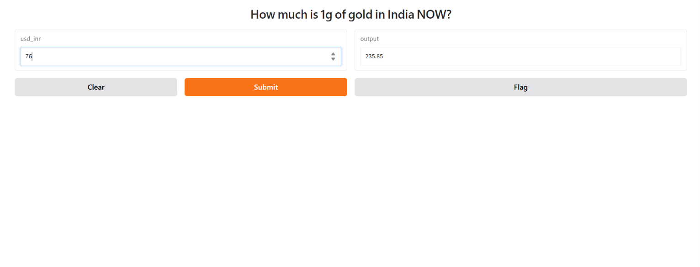

# 🪙 Gold Rate Prediction using Machine Learning

## 📌 Project Overview

This project is a **Machine Learning-based Gold Rate Prediction application** developed using Python and Gradio.

The application takes the **USD-INR exchange rate** as input and uses a trained regression model to predict the **gold rate for 1 gram in India**.

The trained model and scaler are saved using Pickle and loaded into the Gradio application for prediction.

---

## 🎯 Project Objective

The main objective of this project is to build a simple Machine Learning application that can:

* Take USD-INR exchange rate as input.
* Preprocess the input using a saved scaler.
* Use a trained regression model for prediction.
* Display the predicted gold rate.
* Provide an easy-to-use web interface using Gradio.

---

## 🛠️ Technologies Used

* **Python**
* **NumPy**
* **Scikit-learn**
* **Pickle**
* **Gradio**
* **Machine Learning**
* **Regression**

---

## 📂 Project Structure

```text
Gold-Rate-Prediction/
│
├── app.py
├── regressor.pkl
├── scaler.pkl
├── README.md
└── requirements.txt
```

### 📄 File Description

| File               | Description                         |
| ------------------ | ----------------------------------- |
| `app.py`           | Main Python application             |
| `regressor.pkl`    | Trained regression model            |
| `scaler.pkl`       | Saved scaler used for preprocessing |
| `README.md`        | Project documentation               |
| `requirements.txt` | Required Python libraries           |

---

## 🔄 Project Workflow

```text
USD-INR Exchange Rate
          ↓
     Data Scaling
          ↓
   Regression Model
          ↓
      Prediction
          ↓
 Predicted Gold Rate
```

---

## ⚙️ How the Project Works

### 1. Import Libraries

```python
import gradio as gr
import pickle
import numpy as np
```

The project uses Gradio for the interface, Pickle for loading the saved model and scaler, and NumPy for handling the input data.

### 2. Load the Trained Model

```python
model = pickle.load(open(r'regressor.pkl','rb'))
```

The trained regression model is loaded from the `regressor.pkl` file.

### 3. Load the Scaler

```python
scaler = pickle.load(open(r'scaler.pkl','rb'))
```

The saved scaler is loaded to transform the user input before sending it to the model.

### 4. User Input

The user enters the USD-INR exchange rate.

```python
def calculate_goldrate(usd_inr):
```

### 5. Scale the Input

```python
scaled_input = scaler.transform(
    np.array(usd_inr).reshape(1,-1)
)
```

The input is converted into a NumPy array and scaled using the saved scaler.

### 6. Predict Gold Rate

```python
prediction = model.predict(scaled_input)[0]
```

The trained regression model generates the predicted gold rate.

### 7. Display the Prediction

```python
return round(float(prediction.item()), 2)
```

The prediction is converted into a Python float and rounded to two decimal places.

---

## 🖥️ Gradio Interface

The project uses Gradio to create a simple web interface.

```python
demo = gr.Interface(
    fn=calculate_goldrate,
    inputs=["number"],
    outputs=["number"],
    title="How much is 1g of gold in India NOW?"
)
```

The application is launched using:

```python
demo.launch(share=True)
```

This creates a shareable Gradio link while the application is running.

---

## 🚀 How to Run the Project

### Step 1: Clone the Repository

```bash
git clone https://github.com/engsmathan-png/Gold_Rate_Prediction_application.git
```

### Step 2: Open the Project Folder

```bash
cd Gold_Rate_Prediction_application
```

### Step 3: Install Dependencies

```bash
pip install gradio numpy scikit-learn
```

### Step 4: Run the Application

```bash
python app.py
```

The Gradio interface will open in your browser.

---

## 📥 Input

**Input Feature:**

* USD-INR Exchange Rate

## 📤 Output

**Output:**

* Predicted Gold Rate for 1 gram in India

---

## 💡 Key Learning

Through this project, I learned:

* Machine Learning regression
* Data preprocessing
* Feature scaling
* Model prediction
* NumPy
* Pickle for saving and loading ML models
* Gradio interface development
* Deploying a Machine Learning model as a web application

---

## ⚠️ Note

This application provides a **model-based prediction** using the USD-INR value entered by the user. It does not directly fetch live gold prices from the internet.

---

## 👩‍💻 Author

**MATHAN S**

Data Analysis & Data Science

GitHub:
[YOUR_GITHUB_PROFILE_URL](https://github.com/engsmathan-png)